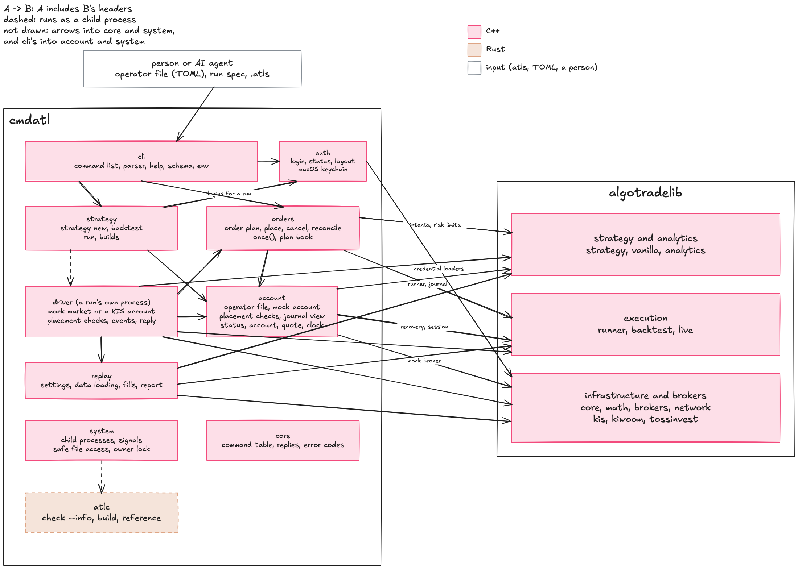

# cmdatl

<!-- badges: start -->
[](https://github.com/algotradelib/cmdatl/actions/workflows/cmake-check.yaml?query=branch%3Amain)
[](https://codecov.io/gh/algotradelib/cmdatl)
<!-- badges: end -->

algotradelib from the command line.
With [algotradelib](https://github.com/algotradelib/algotradelib) alone you write your own C++ for a backtest or a trading loop; with cmdatl you write the strategy in [atls](https://github.com/algotradelib/atlc), describe the run in a TOML file, and backtest and trade it from the command line.
The same commands let an AI agent read an account and place orders one at a time, inside limits the operator sets.

```sh
cmdatl strategy new dip --template mean-reversion      # dip.atls and dip.toml to start from
cmdatl strategy backtest dip.toml -P lookback=30       # atlc builds and replays it; the report as JSON
cmdatl status                                          # the account in one read
cmdatl run start dip.toml                              # a run on its own mock market, in the background
cmdatl run status                                      # its state, and its summary once it ended
```

An agent plans an order, then places that plan:

```sh
cmdatl order plan 005930 --target 10 --limit 78200     # sends nothing; replies with a plan id
cmdatl order place p9cc4b94da4
cmdatl account --value cash                            # one value, nothing else
```

How cmdatl's parts use algotradelib's modules and atlc:



## Install

cmdatl is built with CMake and a C++17 compiler against an installed algotradelib; see [the library's install guide](https://github.com/algotradelib/algotradelib#install).

```sh
cmake -S . -B build -DCMAKE_PREFIX_PATH=/path/to/algotradelib/prefix
cmake --build build
```

Backtesting also needs `atlc`, the atls compiler, on `PATH` or named by `CMDATL_ATLC`, and CMake and a C++17 compiler at run time: `cmdatl strategy backtest` runs `atlc run`, which builds each strategy once against algotradelib and keeps the build.
`cmdatl strategy new` needs neither.

## Strategies

- `cmdatl strategy new NAME` writes `NAME.atls`, a starter program (`--template` `mean-reversion`, `crossover`, `momentum` or `breakout`), and `NAME.toml`, a run spec that reads `bars.csv` beside it (the columns `symbol,date,open,high,low,close,volume`).
  It never replaces a file unless `--force` is given, and then only regular files.
- `cmdatl strategy backtest SPEC` checks the spec with `atlc spec` before anything is built, then runs `atlc run`; the reply carries atlc's report unchanged under `report`, with the `-P` given and atlc's version.
  atlc's build progress and warnings arrive as they happen: on stderr, or as `progress` events with `--format jsonl`.
- `atlc check NAME.atls` checks a program alone; the language is atlc's ([its reference](https://github.com/algotradelib/atlc)).

## The paper account

A paper account trades stored daily bars, not a broker: nothing reaches a network or a real account.
The operator describes it in a TOML file named by `CMDATL_CONFIG`, never by an argument; one account per file.

```toml
atlc = "/opt/atlc/bin/atlc"           # optional: atlc, between CMDATL_ATLC and PATH

[account]
broker = "paper"                      # the only broker of this version
number = "paper-0001"                 # names the account's state directory

[limits]
symbols = ["005930", "000660"]
position = { "005930" = 100, "000660" = 20 }
order_value = 5000000                 # KRW, one order
daily_orders = 3                      # placements per KST date
collar = 0.05                         # optional, at most 0.30
phases = ["open"]                     # optional: pre_open, open, post_close

[paper]
bars = "bars.csv"                     # symbol,date,open,high,low,close,volume, beside this file
cash = 100000000
start = "2024-03-25T09:30"            # KST, at or after the first date's close
```

- Every key is checked: an unknown key, a value of another type or out of range is refused with the file, the line and the column (`config.invalid`); `cmdatl env` shows what was read.
- The armed file is `<stem>.armed` beside the operator's file (`paper.toml` gives `paper.armed`); while it is missing nothing may be placed, and `orders_accepted_now` says so.
- The account's state lives in `$XDG_STATE_HOME/cmdatl/accounts/<broker>-<env>-<number>` (else `~/.local/state/cmdatl`): its lock, its order journal and `paper.jsonl`, the paper market's log.
  Another `XDG_STATE_HOME` is another paper account.
- Keep the operator's file out of the state directory.
  The agent runs as the operator's own user, so the file is advisory until a separate daemon owns the account.

```sh
cmdatl status                                          # time, phase, readiness, positions, cash, owed and working orders, quotes
cmdatl quote 005930 000660                             # last price, band, and whether an order would pass the first gates now
cmdatl account --symbol 005930                         # positions, cash, buying power, owed orders, orders left today
cmdatl order list                                      # working orders
cmdatl clock advance --next-open                       # the paper clock moves only when told; resting orders fill or expire
cmdatl clock advance --minutes 30
```

- `orders_accepted_now` is true exactly when these preliminary gates pass now: the armed file exists, the day's count is known and not used up, the phase is one the operator allows, and the market takes orders for the symbol (08:30-15:30 KST on a date it trades).
  `not_accepted` names the gates that fail.
  A placement still makes its own price, position, value, buying-power and owed-order checks, and may refuse.
- Exit 4 from `cmdatl clock advance` means the advance may have happened: read `cmdatl clock` before advancing again.
- The lock: two cmdatl commands never hold an account at once, provided nobody removes or replaces its `lock` file; a command waits for the account at most 10 s, saying who holds it, then answers `busy.locked`.
- Durability: an input the paper log accepted survives a killed process on local storage; nothing more is promised (not a power loss on macOS, not a network filesystem).
- A journal or a paper log that is missing, damaged or not this account's is exit 4, with what to do in `error.next`, and nothing is written.
  Only a torn last line of an otherwise sound paper log is cut: an input a killed process did not finish writing.

## Orders

An agent moves a position to a target in two steps, a plan and its placement, and nothing places or cancels except through them.

```sh
cmdatl order plan 005930 --target 10 --limit 78200     # what would be sent; a plan id
cmdatl order place p9cc4b94da4                         # sends that plan, if nothing moved since
cmdatl order cancel 005930                             # withdraws every working order on 005930; never places
cmdatl order reconcile                                 # records fills from holdings for every owed order; sends nothing
cmdatl order reconcile 005930
cmdatl order release 005930 --reason "read the order list and holdings"
```

- A target is a position, not a quantity: `--target 0` sells out, and a target the holding and the working orders already meet sends nothing (`met`).
- Every limit comes from the operator's file at the moment of sending; no option of an order command names a limit, phase, collar or order type.
  Every placement is a limit order inside `limits.collar` of the last price and on the tick grid.
- A plan id is bound to what the plan saw: the account, the request, the holding and working orders of the symbol, the cash and the journal's size.
  It is used once, it lapses after `limits.plan_ttl` simulated seconds (60 by default), and anything moving makes it stale (`refused.stale_plan`): plan again.
- Each order command takes one simulated second, as a broker call takes time; `events` is what the market did in that second, which can fill or expire an order already resting, even on a plan or a refusal.
- Exit 3 means nothing reached the market in this call: safe to plan again.
  Exit 4 means an order may have gone out, or the journal cannot say: run `cmdatl order reconcile SYMBOL` before anything else, and read `error.next`.
  A request the market itself refused is exit 4 `unknown.broker_refused`, since it reached the market; `cmdatl order reconcile SYMBOL` then shows nothing owed.
- No reply at all (a killed process): treat it as exit 4.
- `cmdatl order cancel SYMBOL` withdraws by symbol, needs no armed file and runs in any phase; `withdrawal_sent` means sent, not confirmed, and `cmdatl order list` shows when the orders are gone.
- `cmdatl order reconcile` reports each symbol as `clean`, `working` (an order rests), `holding_moved` (holdings changed between two reads) or a refusal's reason; anything still owed afterwards is exit 3 `refused.awaiting`.
- `owed` rows say what to do next; reading them never settles them, only an order command writes the journal.
- An order the broker never named stays owed until the listing settles it or the operator releases it.
  `cmdatl order release SYMBOL --reason TEXT` needs the armed file and the operator's approval `<stem>.release` beside the operator's file (`paper.toml` gives `paper.release`): one line per owed order, `SYMBOL JOURNAL_ID` with one space, naming exactly the journal ids `cmdatl account` shows as owed on that symbol.
  The approval is renamed after one use.
- A damaged journal has no cmdatl remedy: on paper, keep the account's directory for inspection and move it aside, which abandons that paper market with it.

## Runs

A run trades a strategy through algotradelib's live runner, the code that would trade a broker's account, on a mock market built from the run spec's data.

```sh
cmdatl run start dip.toml                              # builds the program once, starts the run, answers when it trades
cmdatl run start dip.toml -P lookback=30 --wait        # waits for the end and answers with the summary
cmdatl run status                                      # the latest run's state, and its summary once it ended
cmdatl run status r3f9c0e12ab45
cmdatl run log --follow                                # each event as the run writes it, until its end
cmdatl run stop --withdraw                             # stop placing and cancel what rests, then wait for the run's end
```

- A run's market is the library's mock broker, inside the run's own process: each run is a fresh market with its own journal, and nothing is shared with the paper account above or with another run.
  The agent commands do not see a run's orders, and a run's holdings at its end are a result, not an account anything can trade.
- The run spec describes the market, exactly as `cmdatl strategy backtest` replays it: the bars, `[replay] cash`, the costs, the instruments.
  The operator's file describes what may be placed: `limits.symbols`, the position caps (a run with several symbols gets the smallest of their caps), `order_value`, `daily_orders` (per run, per 24 hours of market time), `order_type`, `collar` and `phases`; nothing in a spec loosens them.
- A run needs `[replay] market = "kr"`, daily bars from a file (not a store), `[orders] type = "limit"` with an `offset` within `limits.collar`, symbols in `limits.symbols`, and the armed file: each missing one is refused before anything is built.
  It also needs a program without `on_fill` or session legs, a warm-up of at most 10,000 bars, and daily bars: those are refused by the run itself, after the program is built and before anything is placed.
  Every refusal says what to do in `error.next`.
- Every placement is checked once more as the last step before the market: the armed file, a limit inside the collar of the last price, and a permitted phase, closing orders included.
  Daily bars from date-only rows end at 09:00 KST, in `open`; bars stamped at the 15:30 close fall in `post_close`, so a run of those trades only when the operator permits `post_close`.
- The run starts at the first bar and steps through the data 15 market minutes at a time, as fast as the machine allows; at the end it withdraws whatever rests and confirms it before it reports.
  A run's fills are those of `cmdatl strategy backtest` on the same spec when the program decides from bars alone, the bars end on that step (date-only rows do), and none of the operator's limits, the cash or the order budget refuses an order the backtest makes, since the backtest applies none of them.
- `run start` answers once the run trades (exit 0, `state: running`), or with the run's own refusal; `run status` answers 0 whenever it could read the run, and the run's outcome is in `run_exit` and `run_error`.
  A run whose outcome is unknown (killed, a journal write failed, an order it could not confirm) is `run_exit` 4; its market ended with its process and no account was affected.
- `run log` reads the run's events while it trades: without `--follow` the events so far (all but the heartbeats, and the last heartbeat, at most 4,096); with it, each event once as it is written, until the run's `end` line.
  A follow also finishes when the run is over, or its outcome unknown, and its driver has finished writing (its lock free, its exit recorded, or its process gone); without the `end` line (a killed or crashed driver) it says `incomplete: true` and exits 4, and an unknown run without that evidence is followed until Ctrl-C, which stops the watching, never the run.
  `--symbol` keeps only that symbol's order events.
- `run stop` stops a run: `quiesce` (the default) stops new placements and leaves resting orders, `--withdraw` also cancels them; neither sells holdings.
  A quiesce that leaves an order resting ends the run with `run_exit` 4 (`unknown.owed_at_end`), since its market ends with it and the order's fate is then unknown; `--withdraw` ends it clean.
  It writes the run's line into `<stem>.stop` beside the operator's file the run was started with (`paper.toml` gives `paper.stop`), one line per run, every other run's line kept, and waits up to 30 s for the run to acknowledge the stop and end.
  Write the stop file only through `run stop`: it replaces the file by a rename under a lock, `<stem>.stop.lock`, which it creates beside it and keeps, so a hand edit made meanwhile is lost.
  It exits 0 only on evidence that trading ended (the run's reply, or a run already over); acknowledged but not ended is exit 4 `unknown.run_stopping`, not acknowledged is exit 4 `unknown.run_stop`.
  The run's own outcome stays in `run_exit`, so a stop can exit 0 for a run whose `run_exit` is 4.
  The stop file holds at most 4 KiB, and a run notes in its events a stop file it cannot read.
  Removing the armed file also stops every run at its next step.
- A run needs CMake and a C++17 compiler: `run start` builds a program once per shape under `$XDG_CACHE_HOME/cmdatl/drivers` (else `~/.cache/cmdatl/drivers`); a later run of an unchanged program builds nothing, and a change to the program, atlc or algotradelib builds again.

## Output

- Text on a terminal, compact JSON otherwise; `--json` or `--format json|jsonl|text` chooses.
- `--fields a,b.c` keeps only those fields; `--value PATH` prints one value bare, the one reply without `env`.
- Every other reply carries `env`; a failure carries one `error` object with a stable code, such as `refused.position_limit`.
- A field name no reply of the command has is refused before the command runs; one missing from a reply the command already produced comes back with the whole reply and a `warning`.
- Exit codes: 0 ok, 1 failed and nothing sent, 2 usage, 3 refused (safe to retry), 4 unknown (reconcile before anything else), 5 strategy errors, 130 interrupted (Ctrl-C or SIGTERM stopped a command before anything could be sent; it still replies, and once an order command has begun to send it answers with its own outcome instead).
- On a terminal a failure is written to stderr; in JSON it is the reply, on stdout.
- `cmdatl help COMMAND` (or `--help`) shows a command's usage and examples; `cmdatl schema` describes every command, its fields and its error codes for a program.

## Acknowledgements

This project was developed with the assistance of generative AI tools.

## Disclaimer

cmdatl is released under the MIT license; see [LICENSE](LICENSE).
The software is provided as is, without warranty of any kind, and the authors are not liable for any loss, including trading losses, arising from its use.
Nothing in this repository is investment advice.
